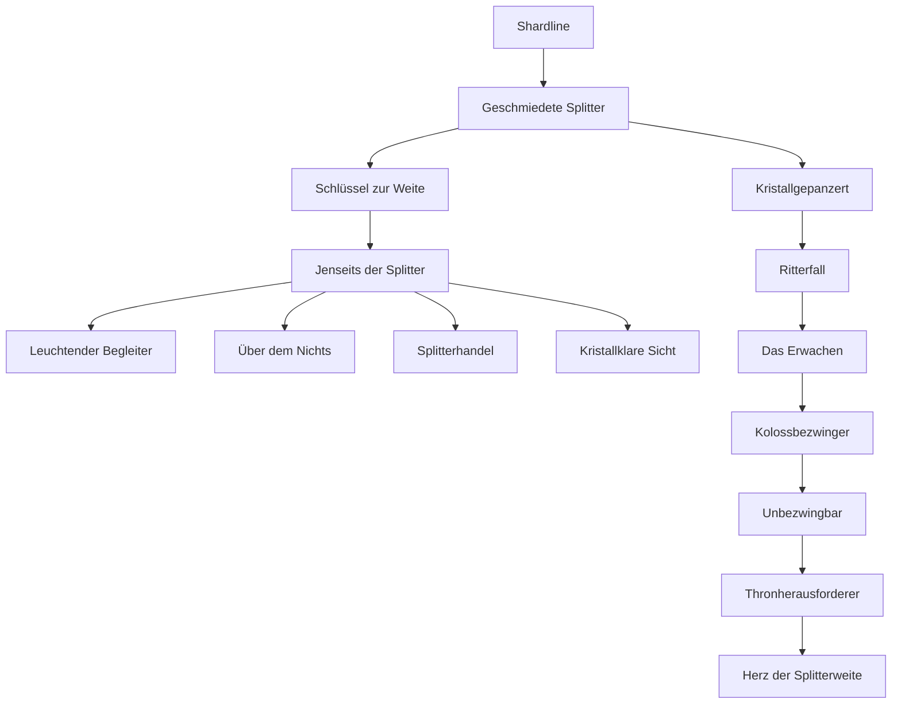

# Advancements

Die Mod hat zwei eigene Tabs im Fortschrittsmenü: **„Shardline“** bildet den [[Fortschritt]] nach, **„Shardline: Chronik“** die Story (siehe [[#Chronik]]).

## Shardline

| Advancement | Bedingung | Art | Belohnung |
|---|---|---|---|
| Shardline | Shard-Splitter oder Rohen Shard besitzen | Aufgabe | – |
| Geschmiedete Splitter | Shard-Barren besitzen | Aufgabe | – |
| Schlüssel zur Weite | Shard-Schlüssel besitzen | Aufgabe | – |
| Jenseits der Splitter | die [[Splitterweite]] betreten | **Ziel** | – |
| Kristallgepanzert | alle 4 Teile der Shard-Rüstung besitzen | Aufgabe | – |
| Leuchtender Begleiter | eine Leuchtmotte zähmen | Aufgabe | – |
| Über dem Nichts | auf einem Void-Rochen reiten | Aufgabe | – |
| Splitterhandel | mit einem Splitterhändler handeln | Aufgabe | – |
| Kristallklare Sicht | Kristallbogen besitzen | Aufgabe | – |
| Ritterfall | einen Gesplitterten Ritter besiegen | Aufgabe | – |
| Das Erwachen | Erweckungskristall auf den Koloss-Altar setzen | Aufgabe | – |
| Kolossbezwinger | den Kristallkoloss besiegen | **Ziel** | 200 XP |
| Unbezwingbar | alle 4 Teile der Kolossrüstung besitzen | **Ziel** | 100 XP |
| Thronherausforderer | Kolosskern auf den Thron der Splitterweite legen | Aufgabe | – |
| Herz der Splitterweite | die Splitterkönigin besiegen | **Herausforderung** | 1000 XP |
| Langsam, aber glänzend | Kristallschleim einer Kristallschnecke sammeln | Aufgabe | – |
| Echo im Stein | einen Resonanzkompass herstellen | Aufgabe | – |
| Kristallhandwerker | Kristallholztür, Kristallglas, Splitterlaterne und gemeißelte Splitterstein-Ziegel besitzen | Aufgabe | – |
| Leuchten von innen | einen Leuchtkappen-Eintopf essen | Aufgabe | – |
| Wo die Hüter tagten | Hüter-Ruinen finden | Aufgabe | – |

## Chronik

Der Tab **„Shardline: Chronik“** (`shardline:story/…`) zeigt die Kapitel und alles rund um Lore, Virus und Ende. Alle Einträge nutzen `minecraft:impossible` und werden vom Server vergeben; jedes Kapitel hat ein eigenes Emblem als Icon. Wer ein späteres Kapitel erreicht, erhält alle vorherigen mit.

| Gruppe | Advancements |
|---|---|
| Kapitel 1–6 | Der erste Splitter, Das Tor, Echos der Hüter, Das Herz der Weite, Der Bruch, Eindämmung |
| Kapitel 7–9 | Das Echo der Wunde; Wiederaufbau **oder** Herrschaft; Der letzte Ton (versiegelt **oder** beherrscht) |
| Lore | Verstaubte Seiten (1 Buch), Chronist von Aurelis (alle 12), Kristallene Erinnerung (1 Vision), Alles, was war (alle 8), Ungehörte Warnung, Neu gebunden |
| Virus und Gegenmittel | Fester Grund (Reinheitsanker), Reines Licht (Essenz), Unberührt (Immunität), Herzstillstand (1 Virusherz), Kern des Bruchs (3 Herzen), Eine Stimme kehrt zurück (Dorfbewohner geheilt) |
| Ende | Am Scheideweg (Altar geweckt), Hüter von Aurelis (versiegelt), Splitterherrscher (beherrscht), Kristallene Gefolgschaft (1 Befallener gezähmt), Kristallherde (Kuh, Schaf, Schwein, Dorfbewohner gezähmt) |
| Nach dem Ausbruch | Der Wunde antworten (Schwäre), Der letzte Nachhall, Gegengesang |
| Epiloge | Stille, Chronik, Waffenstillstand, Alleinherrschaft |

**Meldungen:** Ziele und Herausforderungen werden im Chat verkündet, alle anderen erscheinen nur als Einblendung.

**Rezeptbuch:** Zu jedem Rezept gibt es zusätzlich automatische Advancements, die das Rezept freischalten, sobald man eine Zutat besitzt. Sie erscheinen nicht im Tab.
