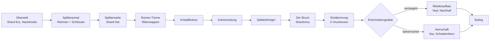

# Fortschritt

Der Fortschrittspfad führt von der Oberwelt über das Portal und zwei Rüstungssets bis zur Splitterkönigin – und danach durch den Shardvirus, die Endentscheidung und die Kapitel 7–9 bis zum Epilog. Jede Stufe schaltet Material für die nächste frei. Parallel dazu läuft die Story in Kapiteln (siehe [[Story und Shardvirus#Kapitel]]); `/shardline story status` zeigt jederzeit das nächste Ziel.

## 1. Oberwelt

- **Shard-Erz:** Es kommt selten in der Tiefenschiefer-Schicht vor (Y −64 bis 0, siehe [[Splitterweite#Oberwelt]]). Abgebaut liefert es *Roher Shard*, geschmolzen den *Shard-Barren*.
- **Nachts:** Selten spawnen Splitterkriecher, Aschewandler, Kristallspinne, Schattenfuchs und Leuchtmotte (siehe [[Mobs]]). Sie lassen *Shard-Splitter* fallen.
- Aus einem Rohen Shard werden 4 Shard-Splitter.

## 2. Das Portal

- **Splitterrahmen:** 4 Shard-Splitter um einen Obsidian ergeben 1 Rahmen.
- Ein Portal braucht mindestens 10 Rahmen (Ecken optional), also 40 Splitter und 10 Obsidian.
- **Shard-Schlüssel:** 2 Shard-Barren, 2 Shard-Splitter und 1 Enderauge.
- Details: [[Splitterportal]]

## 3. Shard-Set

- Das Set wird aus Shard-Barren hergestellt. Es liegt zwischen Eisen und Diamant.
- **Set-Bonus:** Nachtsicht in der Splitterweite und 50 % weniger Schaden durch Splitter-Projektile.
- In der Splitterweite ist Shard-Erz deutlich häufiger als in der Oberwelt.
- Details: [[Ausrüstung#Shard-Set]]

## 4. Ruinen-Türme und Ritterwappen

- In der ganzen Splitterweite stehen Ruinen-Türme, bewacht von **Gesplitterten Rittern**.
- Jeder Ritter lässt garantiert ein **Ritterwappen** fallen.
- Zwei Ritterwappen, 4 Shard-Barren, 2 Diamanten und 1 Leuchtkristall ergeben den **Erweckungskristall**.
- Der [[Splitterhändler]] verkauft eine **Karte zur Koloss-Arena** und manchmal auch einen Erweckungskristall.

## 5. Kristallkoloss

- Setze den Erweckungskristall auf den **Koloss-Altar** in einer Kristallwald-Arena.
- **Beute:** 3–4 Kolosskerne, die Koloss-Schmiedevorlage, die Kolossfaust und die Kolosstrophäe.
- Details: [[Bosse#Der Kristallkoloss]]

## 6. Kolossrüstung

- **Am Schmiedetisch:** Koloss-Schmiedevorlage + Netherit-Teil + Kolosskern ergeben ein Kolossteil.
- Für alle 8 Teile (4 Rüstung, 4 Werkzeuge) braucht man 8 Kolosskerne, also mehrere Kämpfe. Die Vorlage lässt sich mit Diamanten und einem Shard-Block vervielfältigen.
- **Set-Bonus:** Rückstoßimmunität, +4 Herzen und der Kristallschild (Taste V).
- Details: [[Ausrüstung#Koloss-Set]]

## 7. Splitterkönigin

- Lege einen Kolosskern auf den **Thron der Splitterweite** im Zentrum der Dimension (X 0 / Z 0, Y 115).
- **Beute:** Herz der Splitterweite, Splitterklinge der Königin und Königinnentrophäe.
- Details: [[Bosse#Die Splitterkönigin]]

## 8. Der Bruch und die Eindämmung

- Mit dem Tod der Königin bricht der **Shardvirus** aus und breitet sich in der Splitterweite, der Oberwelt, dem Nether und dem End aus.
- **Gegenmittel:** Reinigungsessenz (aus dem Herz der Splitterweite, das als Katalysator erhalten bleibt) und Reinheitsanker mit wachsender Schutzzone.
- **Drei Virusherzen** zerstören → **Kern des Bruchs**.
- Details: [[Story und Shardvirus#Shardvirus]], [[Bosse#Das Virusherz]]

## 9. Die Endentscheidung

- Den Kern des Bruchs auf den **Entscheidungsaltar** vor dem Thron legen.
- **Versiegeln:** Der Virus stoppt, Titel [Hüter] und Umhang der Hüter.
- **Beherrschen:** Der Virus breitet sich weiter aus, Titel [Splitterherrscher], Immunität, Zähmen von Befallenen und die Fähigkeiten Splitterruf (G) und Kristallwelle (H).
- Details: [[Story und Shardvirus#Endentscheidung]]

## 10. Nach dem Ausbruch

- **Kapitel 7:** Überlebendenlager finden, Rhea treffen (Chronik-Tagebuch), erste Aufträge, die erste **Schwäre** mit der Stimmgabel der Hüter zum Schweigen bringen.
- **Kapitel 8:** Aufträge je nach Zweig (Anker-Netz und Archiv bzw. Gefolge und die Stimmlosen).
- **Kapitel 9:** Endkampf gegen den **Nachhall** (versiegelt) oder das **Schwärenherz** (beherrscht), danach Wahl des Epilogs.
- Das **Auftragsbuch** (Taste J) zeigt Kapitel, Aufträge, Figuren und Lore.
- Details: [[Nach dem Ausbruch]]

> [!tip] Orientierung
> Die Splitterweite ist im Maßstab 4:1 an die Oberwelt gekoppelt. Ein Portal bei Oberwelt X 400 / Z 400 führt nach X 100 / Z 100. Wer das Zentrum schnell erreichen will, baut sein Portal nahe der Oberwelt-Koordinaten 0 / 0.
